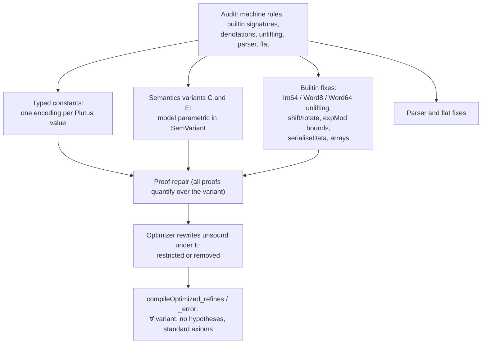
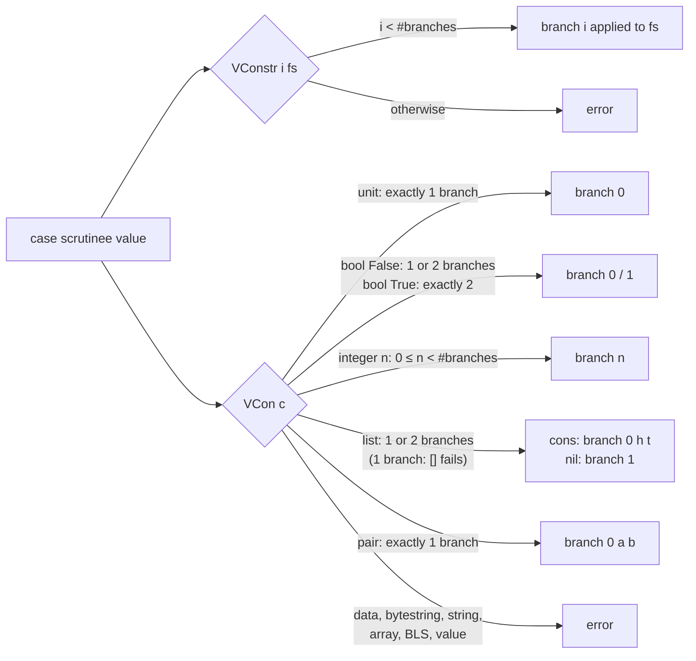

# Fidelity of the Lean CEK model to plutus-core 1.65

Date: 2026-11-07. Branch `model-core-fidelity`.

Every optimizer guarantee (`compileOptimized_refines`, `compileOptimized_error`,
see `MIR-Pipeline-Soundness.md`) is stated against the Lean CEK model in
`Moist/CEK/*` and `Moist/Plutus/Term.lean`. Wherever the model and the real
machine disagree, the guarantee has a hole. This document records the audit of
the model against the reference implementation, plutus-core 1.65.0.0:

- builtin denotations and signatures: `plutus-core/src/PlutusCore/Default/Builtins.hs`
  (cited below as `B:<line>`, the line of the builtin's `toBuiltinMeaning`);
- unlifting and `case` on constants: `plutus-core/src/PlutusCore/Default/Universe.hs` (`U:<line>`);
- the machine: `untyped-plutus-core/src/UntypedPlutusCore/Evaluation/Machine/Cek/Internal.hs` (`I:<line>`);
- bitwise helpers `PlutusCore/Bitwise.hs` (`Bw:<line>`), `PlutusCore/Data.hs` (`D:<line>`),
  `PlutusCore/Crypto/ExpMod.hs` (`X:<line>`).

The cryptographic, BLS12-381 and `Value` builtins are covered by the
`model-opaque-builtins` work and are not audited here.

## Summary

Conformance (`plutus-conformance`, 1003 evaluation tests, run with variant E):

| | before | after |
|---|---|---|
| evaluation | 710 / 1003 | 1003 / 1003 |
| budget | 666 / 710 | 946 / 1003 |

The 293 failures before include the crypto/BLS/Value ones (fixed in
`model-opaque-builtins`). The failures in this audit's scope were: `case-07`,
`constr-06/09/10` (parser), `shiftByteString` case-13/15, `rotateByteString`
case-16/17/18, `indexArray-01`, `lengthOfArray-01/02`, `listToArray-01/02`,
`unMapData-01`, `mkNilPairData`, and `dropList-09/10/14/15/16`. The `dropList`
ones were only the runner's budget: the reference runs conformance unrestricted
and accumulates costs in `SatInt` (saturating `Int64`); the runner now runs
with unbounded limits and saturates the reported cost, and all five pass with
the expected (saturated) budget. Remaining budget mismatches are costing only
(see "Not modelled").

## 1. Constants: typed lists, one encoding per value

The reference carries the type of every constant (`Some (ValueOf uni x)`), and
polymorphic builtins inspect it. The model had no element type on lists
(`ConstList : List Const → Const`) and three duplicate encodings
(`ConstDataList`, `ConstPairDataList`, `PairData`).

| # | Discrepancy | Reference | Effect in the old model |
|---|---|---|---|
| 1.1 | `mkCons` checks the element type against the list's element type with `geq` | B:1669 | `mkCons 1 (con (list bool) [])`, `mkCons True (con (list integer) [2])`, `mkCons (data) (con (list integer) [])` succeeded (also found by the real-machine fuzzer) |
| 1.2 | `constrData`, `listData`, `mapData` unlift `[Data]` / `[(Data, Data)]`: the list type must be exactly `list data` / `list (pair data data)` | B:1737, B:1752, B:1759 | `constrData 0 (con (list integer) [])` succeeded |
| 1.3 | `writeBits` unlifts `[Integer]` | B:2191 | an empty list of any type was accepted |
| 1.4 | The type of a list result is the element type of the argument list (`headList` of `list (list integer)` is a `list integer`) | B:1688 | readback of every list constant said `list data`; an empty `list integer` read back as `list data`, and a non-empty integer list built by `mkCons` read back to a term the flat decoder rejects |
| 1.5 | One value, one encoding | `ValueOf` | `unMapData-01` and `mkNilPairData` returned `ConstPairDataList`, the parser produced `ConstList [PairData ..]` for the same value; flat-decoded data lists were `ConstList [Data ..]` while parsed ones were `ConstDataList`; `mkCons` of `Pair (Data, Data)` onto `ConstPairDataList` failed |
| 1.6 | Arrays carry their element type; `lengthOfArray`, `listToArray`, `indexArray` exist | B:2370, B:2378, B:2387 | no `evalBuiltinConst` arm: every array builtin failed |
| 1.7 | Flat type tag of arrays is `[7, 12]` (`DefaultUniProtoArray`) | U:`encodeUni` | encoder/decoder used `[7, 9]` (the G1 tag); the encoder emitted no array elements |

Fix: `Const.ConstList : BuiltinType → List Const → Const` and
`Const.ConstArray : BuiltinType → List Const → Const` carry the element type;
`ConstDataList`, `ConstPairDataList` and `PairData` are removed. A list of data
is `ConstList (data) [.Data d, ..]` (`Const.dataList`), a pair of data is
`Pair (.Data a, .Data b)` (`Const.pairData`). `constType` is exact. `mkCons`
requires `constType h = ty`; `constrData`/`listData`/`mapData`/`writeBits`
require the exact list type. Parser, flat decoder/encoder, pretty printers,
`ToExpr`, MIR constant equality and the sc-fvt conversion follow.

## 2. Semantics variants

plutus-core 1.65 has builtin semantics variants A–E. PlutusV3 uses C before
protocol version 11 and E from PV11 (the conformance suite and `def` use E).
The model is now parametric: `class inductive SemVariant | C | E`
(`Moist/CEK/SemVariant.lean`), taken as an instance argument by
`evalBuiltinConst`, `evalBuiltin`, `step` and `eval`. Every proof file has
`variable [sv : SemVariant]` (purely syntactic lemmas `omit` it), so every
theorem, in particular `compileOptimized_refines` and `compileOptimized_error`,
holds for both variants. There is no global instance; tests and the
conformance runner pick E explicitly.

| Builtin | C | E | Reference |
|---|---|---|---|
| add/sub/mul/div/quot/rem/mod, `lessThan(Equals)Integer` | unbounded | both arguments `CInteger`: `-2^262143 ≤ x ≤ 2^262143 - 1` | B:1091–1218, U:844 |
| `equalsInteger` | unbounded | unbounded | B:1196 |
| `appendByteString`, `consByteString` (bytes), `sliceByteString`, `indexByteString`, `equals/lessThan(Equals)ByteString`, `decodeUtf8`, `byteStringToInteger`, `and/or/xor/complementByteString`, `readBit`, `countSetBits`, `findFirstSetBit` | unbounded | bytestring arguments `CByteString`: at most 65536 bytes | B:1234–1373, B:1580, B:2095–2289, U:870 |
| `writeBits` | unbounded | input at most 4096 bytes (`maximumInputLength`) | B:2191, Bw:82 |
| `constrData` tag | any `Integer` | `Word64` | B:1737 |
| `shiftByteString`, `rotateByteString` amount | unbounded `Integer` | `Int` (64-bit) | B:2229, B:2244 |

`consByteString` uses `Word8` in both C and E (B:1250). Constant folding folds
a builtin only when C and E agree (`evalBuiltinAgreed`, with
`evalBuiltinAgreed_spec`).

## 3. Builtin denotations (outside the variant table)

| # | Builtin | Reference | Old model | Fixed |
|---|---|---|---|---|
| 3.1 | `shiftByteString` | Bw:596 bit `i` of the result is bit `i - n` | for shifts that are multiples of 8 the carry used `UInt8` shift by 8 (taken mod 8), OR-ing the neighbouring byte in | rewritten on the big-endian natural number |
| 3.2 | `rotateByteString` | Bw:619 | same carry bug (case-17: rotate by `minBound`) | idem |
| 3.3 | `sliceByteString` start/length, `indexByteString`/`readBit`/`indexArray` index | `Int` unlifting (U:`readKnownAsInteger`) | clamped; a start of `2^64` returned `#` | outside Int64 fails |
| 3.4 | `expModInteger` | X:18: modulus `≤ 2^8191 - 1`, base and exponent within `±2^8191`, `b = 0, e < 0` fails | no bounds | bounds added |
| 3.5 | `serialiseData` | D:146–196: tags 121–127, 1280–1400, 102; indefinite non-empty lists, `[]` as `0x80`; bytestrings and big integers chunked by 64 | no arm: always failed | `Serialise.data` |
| 3.6 | `dropList` with `n > maxBound :: Int` | B:2320 `drop maxBound`, structural error if anything remains | `drop n` | exact |
| 3.7 | `replicateByte` byte | `Word8` | checked | unchanged |
| 3.8 | `fstPair`/`sndPair`/list builtins on the duplicate encodings | one encoding | three code paths | one path |

Audited and found to agree (both variants): `addInteger` … `modInteger`
(Haskell `div`/`mod`/`quot`/`rem`), `equalsInteger`, `lengthOfByteString`,
`consByteString` range, `appendString`, `equalsString`, `encodeUtf8`,
`ifThenElse`, `chooseUnit`, `trace` (logs are not observed), `fstPair`,
`sndPair`, `chooseList`, `headList`, `tailList`, `nullList`, `chooseData`
(argument order: data first), `iData`, `bData`, `unConstrData`, `unMapData`,
`unListData`, `unIData`, `unBData`, `equalsData`, `mkPairData`, `mkNilData`,
`mkNilPairData`, `integerToByteString` (Bw:90: width `≤ 8192`, minimal width
`≤ 8192` bytes), `byteStringToInteger`, bitwise and/or/xor padding,
`complementByteString`, `readBit`, `writeBits`, `replicateByte`,
`countSetBits`, `findFirstSetBit`, and every `expectedArgs` force/argument
protocol. Unlifting is deferred to saturation (`Meaning.hs`, "operationally
deferred unlifting"), as in the model.

## 4. Machine rules

Audited `step` against `computeCek`/`returnCek`/`forceEvaluate`/`applyEvaluate`
(I:819–1031) and `caseBuiltin` (U:915): agree.

The tail of a list keeps the list's element type (fix 1.4). `constr` tags are
`Word64` (I:316); the model's tags are `Nat` and the parser now rejects tags
`≥ 2^64`.

## 5. Parser and flat

| # | Test | Reference | Fix |
|---|---|---|---|
| 5.1 | `case-07`, `constr-06`, `constr-10` | `case`/`constr` require program version `1.1.0` | rejected before 1.1.0 |
| 5.2 | `constr-09`, `constr-10` | tag `≤ maxBound :: Word64` | rejected |
| 5.3 | list/array/pair literals | typed | `ConstList ty`, `ConstArray ty`, plain `Pair` |
| 5.4 | flat array tag | `[7, 12]` | fixed; array elements encoded |

## 6. Consequences for the optimizer

All proofs now quantify over the variant. Rewrites whose proofs relied on
variant-C behaviour were restricted or removed:

| Rewrite | Problem under E | Change |
|---|---|---|
| `totalWithFacts`: add/sub/mul/`lessThan(Equals)` on known integers return | fail on arguments beyond `±2^262143` | requires `boundedInteger` operands (literals below `2^64`, through let-variables); `equalsInteger` unchanged |
| `integerIdentity` (`x+0`, `0+x`, `x-0`, `x-x`, `x*1`, `x*0`, `div/quot x 1`, `rem/mod x 1`, `x<x`, `x≤x`) | the source fails on a huge `x`, the result does not | requires bounded operands; `equalsInteger x x → True` unchanged |
| TagChains `rangeRule` (failing `equalsInteger` chain → `lo ≤ tag ≤ hi`) | `lessThanEqualsInteger` fails on a huge tag where the equality tests return `False` | requires a bounded tag and bounds below `2^64` |
| `insertKeyBytes` (`appendByteString #00 k` after `k = unBData d`) | fails when `|k| > 65536` while the source halts | removed |
| `dataComparison` (`equalsData d x` → `equalsByteString k (unBData (chooseData x o o o o x))`) | fails when `x` is a `B` value longer than 65536 bytes, where `equalsData` returns `False` | removed |
| constant folding | — | folds only when C and E agree |

Round trips (`unListData (listData l) → l`, `unMapData (mapData m) → m`) now
require a literal to be a typed `list data` / `list (pair data data)` all of
whose elements are data values / data pairs.

## 7. Not modelled / remaining gaps

- Budgets: costing is not part of `step` and the model has a single cost
  model, not one per variant. 57 conformance
  budget mismatches remain (integer division family, `expModInteger`,
  `equalsByteString`, `equalsString`, `appendString`, `encodeUtf8`, the
  hashes); they do not affect the halt/error semantics the proofs use.
- `Term.Constant (c, ty)` keeps an annotation `ty` that the machine ignores and
  the flat encoder uses. A constant whose annotation differs from `constType c`
  has no plutus-core counterpart; the parser and decoder never produce one, but
  nothing in `compileOptimized` checks it.
- `trace` messages are not observed.
- `decodeUtf8` relies on Lean's `String.validateUTF8` agreeing with
  `Data.ByteString.isValidUtf8`; the conformance `decodeUtf8` tests pass, no
  proof of the agreement exists.
- Variants A, B and D (PlutusV1/V2) are not modelled.
