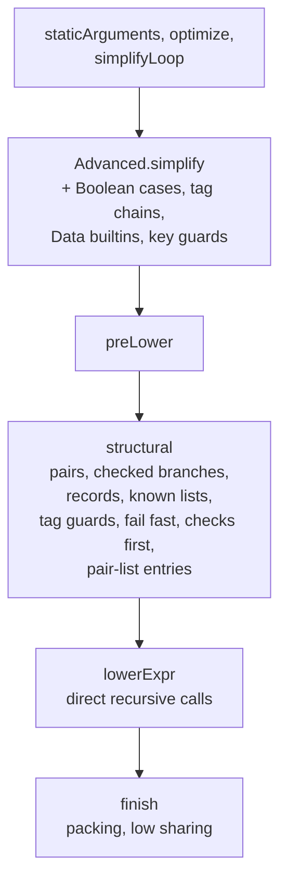

# Cross-language benchmark: Moist, Aiken, Plinth, Plutarch

Date: 2026-11-07. Raw data: [benchmarks/cross-language.csv](benchmarks/cross-language.csv) (current
optimizer) and [benchmarks/cross-language-baseline.csv](benchmarks/cross-language-baseline.csv) (the optimizer
before the passes listed under [Optimizer expansion](#optimizer-expansion)).

## What was measured

Nine contracts from `plinth-plutarch-comparison` (branch `cross-language-bench`): Voting, Certifying, Vesting,
Constitution, Crowdfund, Settings, the Hydra head validator, CIP-143 ProgrammableLogicGlobal, and the `Sample`
recursive function. Each exists in four languages:

| Compiler | Version | Source |
|---|---|---|
| Moist | this branch, Lean 4.24 | `Test/Comparison/Validators.lean`, `Test/Comparison/Cross/*.lean` |
| Aiken | 1.1.24, stdlib v4.0.0, `-t silent` | `plinth-plutarch-comparison/aiken/<Validator>/` |
| Plinth | plutus-tx 1.65.0.0, GHC 9.6.6 | `plinth-plutarch-comparison/src/*/*Plinth.hs` |
| Plutarch | 1.12 fork `011f6e18` | `plinth-plutarch-comparison/src/*` |

A second set of ten edge-case scripts exists in Moist and Aiken only (see [Edge-case suite](#edge-case-suite)).

Moist is measured with default options (`moist`) and with the older size options, builtin sharing and constant
pooling (`moist-size`). The claims below are about the default build alone.

Every script runs through one evaluator, the plutus-core 1.65.0.0 CEK machine in counting mode
(`cross-bench` in the comparison repo), on identical arguments. Each validator is checked against two input sets:

- **bench:** the repository's 152 benchmark scenarios. The tables use only these.
- **test:** its 169 named accept/reject unit cases.

Costs are reported for cost-model variant C. Variant E gives the same winner on every case. Size is the
CBOR-wrapped flat script as stored on chain.

On a failing run the CEK machine charges machine steps only in completed blocks of 200, so reject-case costs move
in steps of about 3.2M CPU and 20k memory.

## Faithfulness

The Plinth source is the specification.

- **Conformance:** every Moist and Aiken port agrees with Plinth and Plutarch on all 321 bench and test cases under
  both variants.
- **Malformed input:** user-supplied Data (datums, redeemers, script parameters) is accepted or rejected exactly as
  Plinth does. Differential testing ran every port against `plinth.flat` on mutated inputs: wrong constructor tags,
  extra or missing fields, wrongly typed fields, and list edits, to depth 4. In total that was over 100,000 mutated
  contexts, with 0 mismatches for every Moist and Aiken script.
  After the optimizer expansion the Moist scripts were re-checked the same way: 78,824 mutated inputs across the
  nine validators, each evaluated under both cost-model variants, with 0 mismatches against Plinth.
- **Ledger-built data:** structures the ledger builds are read with the guarantees the ledger gives a real V3
  ScriptContext, for example normalized, sorted `Value`s.
- **Plutarch:** the Plutarch scripts are the repository's originals. They differ from Plinth on some malformed data.
- **Plinth fix:** the repository's Plinth ProgrammableLogicGlobal rejected every valid SeizeAct. Its final check
  `check || error ()` evaluated `error ()` even when the check held. The fix (`711dd87`) rewrites it as an `if`.
  The conformance suite now passes all 465 tests, against 461 before.
- **Ports unchanged:** the Moist ports are the same as in the baseline. Every gain below comes from the compiler.

## Results

### Total bench CPU (variant C)

| Validator | moist | moist-size | aiken | plinth | plutarch |
|---|---|---|---|---|---|
| Voting | 44.4M | **44.3M** | 66.5M | 78.0M | 82.8M |
| Certifying | 16.1M | **16.0M** | 40.0M | 38.0M | 38.9M |
| Vesting | **429.7M** | 430.8M | 750.0M | 1,015.6M | 884.3M |
| Constitution | **178.7M** | 182.2M | 340.5M | 485.3M | 355.2M |
| Crowdfund | **376.6M** | 377.1M | 702.7M | 965.6M | 1,178.9M |
| Settings | **1,134.0M** | 1,134.2M | 2,126.7M | 2,427.8M | 2,235.1M |
| Hydra | 317.4M | **317.3M** | 754.8M | 1,539.6M | 435.8M |
| ProgrammableLogicGlobal | **1,047.6M** | 1,048.3M | 1,564.1M | 1,594.7M | 1,382.7M |
| Sample | 221.8M | **215.9M** | 566.4M | 608.1M | 631.8M |

### Total bench Memory (variant C)

| Validator | moist | moist-size | aiken | plinth | plutarch |
|---|---|---|---|---|---|
| Voting | 77.9k | **77.1k** | 212.3k | 184.7k | 200.9k |
| Certifying | 45.3k | **44.5k** | 93.5k | 98.3k | 98.1k |
| Vesting | **1.2M** | 1.2M | 2.0M | 2.8M | 2.4M |
| Constitution | **727.9k** | 749.7k | 1.2M | 1.7M | 1.2M |
| Crowdfund | **1.1M** | 1.1M | 1.9M | 2.9M | 3.2M |
| Settings | **3.1M** | 3.1M | 5.7M | 6.8M | 5.6M |
| Hydra | 938.1k | **937.1k** | 2.2M | 6.3M | 1.2M |
| ProgrammableLogicGlobal | **2.7M** | 2.7M | 4.1M | 4.8M | 3.8M |
| Sample | 973.5k | **936.5k** | 1.8M | 2.1M | 2.2M |

### Script size (CBOR bytes)

| Validator | moist | moist-size | aiken | plinth | plutarch |
|---|---|---|---|---|---|
| Voting | **149** | 151 | 295 | 244 | 272 |
| Certifying | 224 | **220** | 316 | 381 | 317 |
| Vesting | **636** | 640 | 859 | 1,177 | 1,219 |
| Constitution | **698** | 704 | 817 | 791 | 769 |
| Crowdfund | **1,327** | 1,329 | 1,604 | 2,169 | 1,888 |
| Settings | **1,754** | **1,754** | 1,922 | 2,405 | 2,162 |
| Hydra | 5,256 | **5,240** | 7,548 | 9,615 | 6,001 |
| ProgrammableLogicGlobal | **3,110** | **3,110** | 3,828 | 3,918 | 4,080 |
| Sample | **67** | 69 | 118 | 131 | 109 |

### Geometric mean vs Plinth over all bench cases (variant C; lower is better)

| Compiler | CPU | Memory | Size |
|---|---|---|---|
| moist | 0.39x | 0.34x | 0.64x |
| moist-size | 0.39x | 0.34x | 0.64x |
| aiken | 0.78x | 0.72x | 0.88x |
| plinth | 1.00x | 1.00x | 1.00x |
| plutarch | 0.83x | 0.75x | 0.90x |

Bold marks the best value in each row.

### Summary

- **Every case:** the default Moist build is strictly cheaper than Aiken, Plinth and Plutarch in both CPU and
  memory on all 152 bench cases, reject cases included, under both cost-model variants.
- **Every size:** the default build is the smallest script on all nine validators. The closest margins are
  Constitution (698 against Plutarch's 769) and Settings (1,754 against Aiken's 1,922).
- **Tightest case margins:** reject cases are charged in 200-step blocks, so a change that adds a few steps
  before a check can cost a whole block. The closest wins are the Settings admin rejects (about 1.6k memory below
  Aiken) and, in the edge suite, ValueLookup "last of 30x3" (133,372 memory against Aiken's 133,758).
- **Against Plinth:** per-case CPU is 0.39× and memory 0.34×, against Aiken's 0.78× and 0.72× and Plutarch's 0.83× and
  0.75×. Script size is 0.64× Plinth.
- **`moist-size`:** this profile is now within a few percent of the default build and is no longer needed to win
  on size.

### Moist default build: before and after (variant C, bench totals)

| Validator | Size before | Size after | CPU before | CPU after | Memory before | Memory after |
|---|---|---|---|---|---|---|
| Voting | 182 | 149 | 58.3M | 44.4M | 116.0k | 77.9k |
| Certifying | 346 | 224 | 34.3M | 16.1M | 93.1k | 45.3k |
| Vesting | 807 | 636 | 586.9M | 429.7M | 1.6M | 1.2M |
| Constitution | 986 | 698 | 307.9M | 178.7M | 1.1M | 727.9k |
| Crowdfund | 1,534 | 1,327 | 510.0M | 376.6M | 1.4M | 1.1M |
| Settings | 2,153 | 1,754 | 1,385.4M | 1,134.0M | 3.8M | 3.1M |
| Hydra | 6,869 | 5,256 | 412.0M | 317.4M | 1.2M | 938.1k |
| ProgrammableLogicGlobal | 3,571 | 3,110 | 1,244.4M | 1,047.6M | 3.3M | 2.7M |
| Sample | 93 | 67 | 330.8M | 221.8M | 1.5M | 973.5k |

Before the expansion the default build lost 28 of 226 bench cases (main and edge suites) on CPU or memory and lost
on size on Certifying, Constitution, Settings and Hydra.

## Edge-case suite

Ten scripts written in Moist (`Test/Comparison/Edge/*.lean`) and Aiken (`plinth-plutarch-comparison/aiken/edge`),
each checked against a Python reference (`aiken/edge/gen_cases.py`) on 74 bench cases. Each targets one pattern:
list folds, map plus filter, wide records, Value lookup, enum dispatch, a guard after expensive work, byte search,
nested lists, polynomial evaluation, and short-circuiting all/any.

| Script | Bench cases | Moist size | Aiken size | Moist CPU | Aiken CPU | Moist memory | Aiken memory |
|---|---|---|---|---|---|---|---|
| AllAny | 8 | **105** | 156 | **583.6M** | 1,114.2M | **2.4M** | 3.3M |
| ByteSearch | 8 | **51** | 134 | **264.7M** | 539.0M | **1.2M** | 1.8M |
| EnumDispatch | 8 | **252** | 328 | **13.0M** | 24.1M | **49.8k** | 86.5k |
| GuardOrder | 8 | **42** | 77 | **134.0M** | 259.7M | **611.5k** | 839.6k |
| Horner | 7 | **46** | 68 | **159.9M** | 268.7M | **649.5k** | 848.9k |
| ListSum | 7 | **37** | 58 | **164.7M** | 317.5M | **751.8k** | 1.0M |
| MapFilterCount | 7 | **112** | 156 | **751.4M** | 1,312.3M | **3.1M** | 4.4M |
| NestedLists | 7 | **100** | 121 | **280.6M** | 448.7M | **1.2M** | 1.5M |
| ValueLookup | 8 | 274 | **219** | **78.0M** | 108.4M | **359.1k** | 368.6k |
| WideRecord | 6 | **63** | 83 | **14.9M** | 22.3M | **43.1k** | 55.4k |

Moist is strictly cheaper than Aiken in both CPU and memory on all 74 edge bench cases, under both cost-model
variants, and smaller on nine of the ten scripts. ValueLookup is the exception: comparing map keys quickly and
correctly under variant E (see [Correctness](#correctness)) costs a kind and length check per key, which makes it
274 bytes against Aiken's 219.

## Optimizer expansion

Each pass below is proved for every MIR expression and for both builtin semantics variants, and
`compileOptimized_refines` and `compileOptimized_error` (`Moist/Verified/CompilerSoundness.lean`) keep their
statements, quantified over the variant (`[sv : SemVariant]`) and otherwise with no hypotheses and only the
standard axioms.

| Pass | What it does | Certificate |
|---|---|---|
| Direct recursive calls | Lowers a recursive call to `[[s s] a]` instead of `[(λv. s s v) a]` | `fixLamWrap_forward`, `fixLamWrap_backward` |
| Pair case through aliases | Destructures a pair with one `case` when its projections were shared into variables | `destructureProducts_refines` |
| Known-list case fusion | Turns `nullList` plus a list `case` into one list `case` on values known to be lists, including recursive parameters | `fuseKnownListCases_refines` |
| Tag chains | Compiles constructor-tag test chains ending in `error` to an integer `case` | `caseTagChains_refines` |
| Boolean cases | Bool-result analysis through helpers and fields, Bool case-of-case, `case b [False, True]` to `b` | `booleanCaseRewrite_factRel`, in `simplify_refines` |
| Fail fast | Moves strict work below terminating checks, prechecks decoded constructor tags, runs checks before decoding | `failFast_refines`, `tagGuards_refines`, `checksFirst_refines` |
| Low sharing | Shares repeated closed terms at their lowest dominating node, only where no successful run gets slower; now the default | `shareLow_refines` |
| Record unpacking | Reads a record's fields with one `case` when a return-shape analysis proves its constructor and arity | `unpackRecords_refines` |
| Data builtins | Removes encode/decode round trips and checks Data kinds with the unData builtin | `specializeDataChecks_refines` |
| Guarded key comparison | Compares a key known to be `B k` with `equalsByteString` behind a kind and length check, falling back to `equalsData` for keys over 64 bytes, so variant E's 65,536-byte bound is never reached | `insertKeyGuards_refines`, `keyComparison_factRel` |
| Pair-list entries | Destructures entries of lists from `unMapData` (including through recursive loop parameters) with one `case` | `destructurePairEntries_refines` |

Rewrites that were only correct under variant C were restricted: integer identities and integer totality facts
need operands below 2^64, the tag-chain range test needs a small tag, and constant folding only folds when both
variants agree.



## Correctness

The proofs are relative to a Lean model of the CEK machine, so the model was checked against plutus-core 1.65 and
the optimizer was tested on the real machine.

- **Model fidelity:** the model now passes all 1,003 official conformance evaluation tests (710 before). Lists and
  arrays carry their element type and every Plutus value has one encoding; the array builtins, shift/rotate bounds,
  `expModInteger` bounds and `serialiseData` were fixed; cryptographic and BLS builtins are `opaque` to proofs (real
  implementations at run time) and BLS points carry their bytes; the Value builtins follow plutus-core. Details and
  the remaining cost-only differences are in [CEK-Model-Fidelity.md](CEK-Model-Fidelity.md).
- **Semantics variants:** the model is parametric in the builtin semantics variant, C (mainnet PlutusV3 today) and
  E (from the van Rossem protocol version, with integer and bytestring bounds). The compiler output does not depend
  on the variant and is proved correct under both, so a deployed script stays correct across the switch.
- **Serialization:** six BLS builtins had wrong flat tags, the encoder wrote a constant's annotation instead of its
  value's type, and large constants made encoding quadratic or overflow the stack. All are fixed and tested.
- **Real-machine fuzzing:** the optimizer was compared with the unoptimized lowering on the real plutus-core 1.65 machine
  under both variants: 5,000 typed and 2,000 untyped generated programs, 358 probes (case on builtin values, list,
  pair and Data builtins, crypto, BLS, Value, values at the variant E bounds, map keys around the guarded
  comparison's lengths), all 19 validators on 108,477 cases and mutated inputs, and 1,900 mutated validators.
  Each program ran as roughly 80 variants (each pass alone, every pipeline prefix, `compileOptimized` under 22
  option sets), 38.27M comparisons in total, with 0 discrepancies: whenever the unoptimized program halted the
  optimized one halted with an equal value, and whenever it failed the optimized one failed. The Lean model agreed
  with the real machine on 1.61M comparisons except one budget-only case (see CEK-Model-Fidelity.md). The tooling
  is `Test/MIR/FuzzReal/` (`run_campaign.sh` reruns it with fixed seeds) and `cross-bench batch` in the comparison
  repo.
- **Limits found by stress testing:** Data nested about 100k levels deep overflows the stack in encoding,
  readback and compilation (works to 70k; pretty printing to 30k). A 16,384-byte transaction can carry at most about
  16k levels, so this is not reachable on chain. Flat decoding and some model builtins are slow on very large values.

## Moist issues found while porting

- **Translator bug.** A partially applied `@[plutus_sop]` constructor is lowered to a `constr` with missing fields.
  For example, `let make := Pair.mk 1; make x` becomes `constr(0 1) x`, which errors at runtime. The fully applied
  form is correct. The bug is in the Lean-to-MIR translator, which runs before the verified pipeline. The Hydra port
  works around it with an explicit lambda.
- **Typed entry parameters.** `compile!` does not decode entry parameters of type `List Int`, `Int`, `ByteString`
  or `AssocMap` from `Data`, so such scripts fail on every input. The edge ports take `Data` and decode where used.
- **Per-call copies.** `translateConst` copies an `@[onchain]` definition's body into every call site. The low
  sharing pass re-shares the closed copies.
- **eDSL bindings added:** `serialiseData` and `chooseData` were missing from `Moist/Onchain/Prelude.lean`. They are
  new builtin bindings only.
- **eDSL limits.** These are worked around in the ports:
  - The translator does not support mutual recursion.
  - Recursion over nested inductive types needs `termination_by sizeOf`.
  - Recursion on two lists packs both arguments into a tuple on every step.
  - Each reference to a recursive helper is inlined as a separate copy, so the ports share helpers by passing them
    as arguments.
  - `DropList` is not exposed.

## Reproduction

```sh
# Moist scripts (all 19 validators, including Edge*)
lake build cross_bench_export && .lake/build/bin/cross_bench_export
# Aiken scripts: in each plinth-plutarch-comparison/aiken/<Validator>, run aiken build -t silent and copy
# validators[0].compiledCode to /Users/sho/fun/cross-bench-data/<Validator>/aiken.cbor.hex;
# for the edge suite run plinth-plutarch-comparison/aiken/edge/export.sh
# Inputs, Plinth/Plutarch scripts, and the evaluation (in plinth-plutarch-comparison)
cabal run cross-bench -- export
python3 aiken/edge/gen_cases.py
cabal run cross-bench -- run > cross-language.csv
# Inspect a script or a case: cross-bench inspect --validator V [--case NAME]
```
