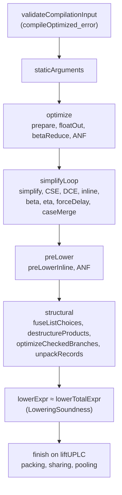

# Soundness of the production compiler

Date: 2026-11-07. This replaces the coverage table in
`MIR-Remaining-Pass-Proofs.md`, which is kept as a historical checkpoint.

## Main theorem

`Moist/Verified/CompilerSoundness.lean`:

```lean
theorem compileOptimized_refines {e : Expr} {optFresh lowerFresh : Nat}
    {options : Advanced.Options} {t : Term}
    (h : compileOptimized e optFresh lowerFresh options = .ok t) :
    ∃ t₀, lowerTotalExpr [] e = some t₀ ∧ CtxRefines t₀ t

theorem compileOptimized_error {e : Expr} {optFresh lowerFresh : Nat}
    {options : Advanced.Options} {msg : String}
    (h : compileOptimized e optFresh lowerFresh options = .error msg) :
    validateCompilationInput [] e = .error msg
```

These theorems have no hypotheses. They hold for every MIR program, every
fresh-name start and every option set, including builtin-state sharing and
constant pooling. In words:

- If compilation succeeds, the source has a certified lowering `t₀`, and the
  emitted UPLC contextually refines it. In every closing context, the output
  stays closed, and whenever the source halts or errors, so does the output.
- Compilation fails only when the input validator rejects the program.

`Test/MIR/Opt/Axioms/Compiler.lean` checks that both theorems depend only on
`propext`, `Classical.choice` and `Quot.sound`.

## How the proof is assembled

Every stage is proved for every MIR expression. `PipelineSoundness.lean`
composes the stages with `mirCtxRefines_trans` through the actual
`simplifyLoop`, `optimize`, `preLower` and `prepareForLowering` definitions.
`LoweringSoundness.lean` relates the production `lowerExpr` to the certified
`lowerTotalExpr`. The two lowerings encode recursive functions differently,
and are related by contextual refinement in both directions.
`liftUPLC_lowerExpr` gives an exact round trip for the post-lowering
allocation stage.



## Whole-pass certificates

Each entry is `MIRCtxRefines e (pass e …)` for every expression `e`, and for
every fresh state, fuel or option the pipeline can pass. Each one has an axiom
check under `Test/MIR/Opt/Axioms/` or in `Test/MIR/Opt/FormalAxioms.lean`.

| Stage | Certificate | File |
|---|---|---|
| ANF normalization | `anfNormalize_refines` | `ANFSoundness.lean` |
| DCE | `dce_refines` | `DCESoundness.lean` |
| Inline | `inline_refines` | `InlineSoundness.lean` |
| Binder hygiene | `uniqueOptimizationBinders_refines`, `_lower` | `HygieneSoundness.lean` |
| Beta reduction | `betaReducePass_refines` | `BetaReduceSoundness.lean` |
| Eta reduction | `etaReduce_refines` | `EtaReduceSoundness.lean`, `EtaReduce/` |
| Float-out | `floatOut_refines` | `FloatOutSoundness.lean` |
| CSE | `cse_refines` | `CSESoundness.lean` |
| Force/delay cancellation | `forceDelay_refines` | `ForceDelaySoundness.lean` |
| Known-constructor case merge | `caseMergePass_refines` | `CaseMergeSoundness.lean` |
| Delay sharing, `prepare` | `shareDelayedValues_refines`, `prepare_refines` | `DelaySharingSoundness.lean` |
| Dead `Fix` elimination | `eliminateDeadFix_refines` | `DeadFixSoundness.lean` |
| Static recursive arguments | `staticArguments_refines` | `StaticArgumentsSoundness.lean` |
| Scalar / Data folding | `constantFold_refines`, `foldDataConstructors_refines` | `ConstantFoldingSoundness.lean`, `DataFoldingSoundness.lean` |
| List destructor fusion | `fuseListDestructors_refines` | `ShapesSoundness/Destructors.lean` |
| List choice fusion | `fuseListChoices_refines` | `ShapesSoundness/Choices.lean` |
| Shape DCE, choice simplification | `shapeDCE_refines`, `simplifyChoices_refines` | `ShapesSoundness/Simplify.lean` |
| `Advanced.simplify` | `simplify_refines` | `ShapesSoundness/Pipeline.lean` |
| Pre-lowering inline, `preLower` | `preLowerInlineExpr_refines`, `preLower_refines'` | `PreLowerSoundness.lean`, `CompilerSoundness.lean` |
| Product destructuring | `destructureProducts_refines` | `ProductsSoundness.lean` |
| Checked list branches | `lowerDelayedListChoices_refines`, `fuseCheckedListBranches_refines`, `optimizeCheckedBranches_refines` | `CheckedBranchesSoundness.lean` |
| Record unpacking | `unpackRecords_refines` | `RecordsSoundness.lean`, `RecordsSoundness/` |
| `Advanced.structural` | `structural_refines` | `CompilerSoundness.lean` |
| Application packing | `packApplications_refines` | `ApplicationPackingSoundness.lean` |
| Builtin sharing, constant pooling | `hoistBuiltinStates_refines`, `poolConstants_refines` | `SharingSoundness.lean` |
| `Advanced.finish`, all options | `finish_refines` | `AllocationFinishSoundness.lean` |
| Lowering | `lowerExpr_sound`, `lowerExpr_complete`, `liftUPLC_lowerExpr` | `LoweringSoundness.lean`, `FixLowering.lean` |

Reusable fact infrastructure for the shape-driven passes lives in
`Moist/Verified/ShapeFacts/`. It provides fact environments (`FactsHold`), the
fact-indexed relation `FactRel` with congruences, soundness of `resolveHead`,
and the known-shape analyses. The return-shape analysis `shapeOf` (constructor
tags with field shapes, through bindings, `case` alternatives and forced
`ifThenElse`/`chooseList` selections) is proved in
`RecordsSoundness/Analysis.lean`.

## Totality

Lean cannot reason about `partial def`, so every pass the pipeline calls is
now a total function. Each uses structural recursion, `termination_by` on
expression size, or explicit fuel with a fuel-irrelevance proof. This covers
`optimize`, `simplifyLoop`, the shape walks, the product and
checked-branch walks, and the equality checkers (`alphaEq`, `constEq`,
`dataEq`).

## Bugs found while proving

All of these are fixed:

- The shape-DCE bug has a kernel-checked counterexample.
- The pair and array bugs have regression tests.
- The lowering and shadowing fixes are covered by the certificates themselves.

- **`constEq` on pairs:** it compared the two components of the same pair
  constant, so distinct pair literals counted as alpha-equal. It now compares
  the components pointwise. Regression tests are in `Test/MIR/Analysis/Unit.lean`.
- **`alphaEq` on array constants:** it was not reflexive, and eta reduction
  looped forever on lambdas containing array literals. `constEq` and
  `typeOperatorEq` now handle arrays, and there is a regression test
  `eta_array_literal_body`.
- **Shape-checked simplification:** the generated `checked` binder was fresh
  only within the rewritten case, so it could reuse an outer binder's name. The
  Boolean analysis then treated an integer as a Boolean and folded a failing
  case to `0`. `ShapeCertificates.lean` has `checked_binder_capture_not_refines`.
  Generated binders now start above every input binder.
- **Production lowering:** it accepted `Fix h (Var f)` where `f` names an
  enclosing recursive function, which the certified lowering rejects.
  `compileOptimized` validated its input first, so the compiler was never
  affected. `liftUPLC` now maps the out-of-range `Var 0` to `Error`.
- **Shadowing in internal workers:** `removeForces`, force/delay through `let`,
  static arguments, CSE renaming and float-out could capture variables if
  binders were reused. In the pipeline, `uniqueOptimizationBinders` always ran
  first, so no output changed. Each pass now has its own guard.

The `budget_exhaustion` axiom and the unused equivalence tower
(ObsEq/CtxEq/MIRCtxEq/BehEq) were removed. `Moist.Verified` declares no axioms.

## Scope

The contract is contextual halting/error refinement through `lowerTotalExpr`
on the Lean CEK machine. It does not cover:

- execution-budget preservation
- trace equivalence
- correspondence with the native plutuz CEK machine
- Flat encoding

Optimization quality is checked separately. `checked_branch_bench` output (CPU,
memory and size for all 252 rows) is byte-identical to the output before this
work.
